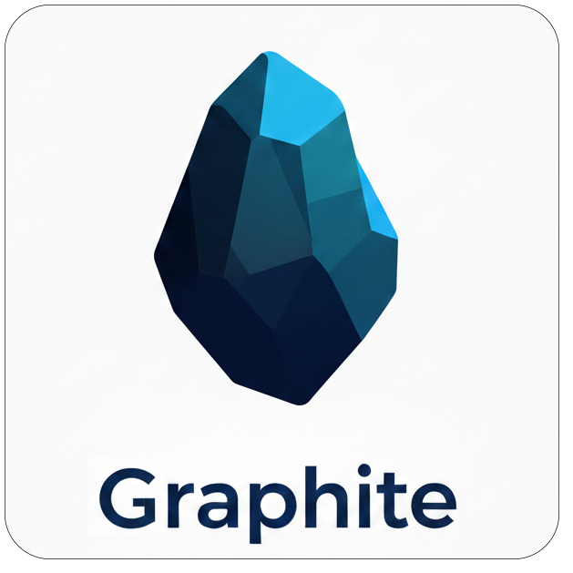
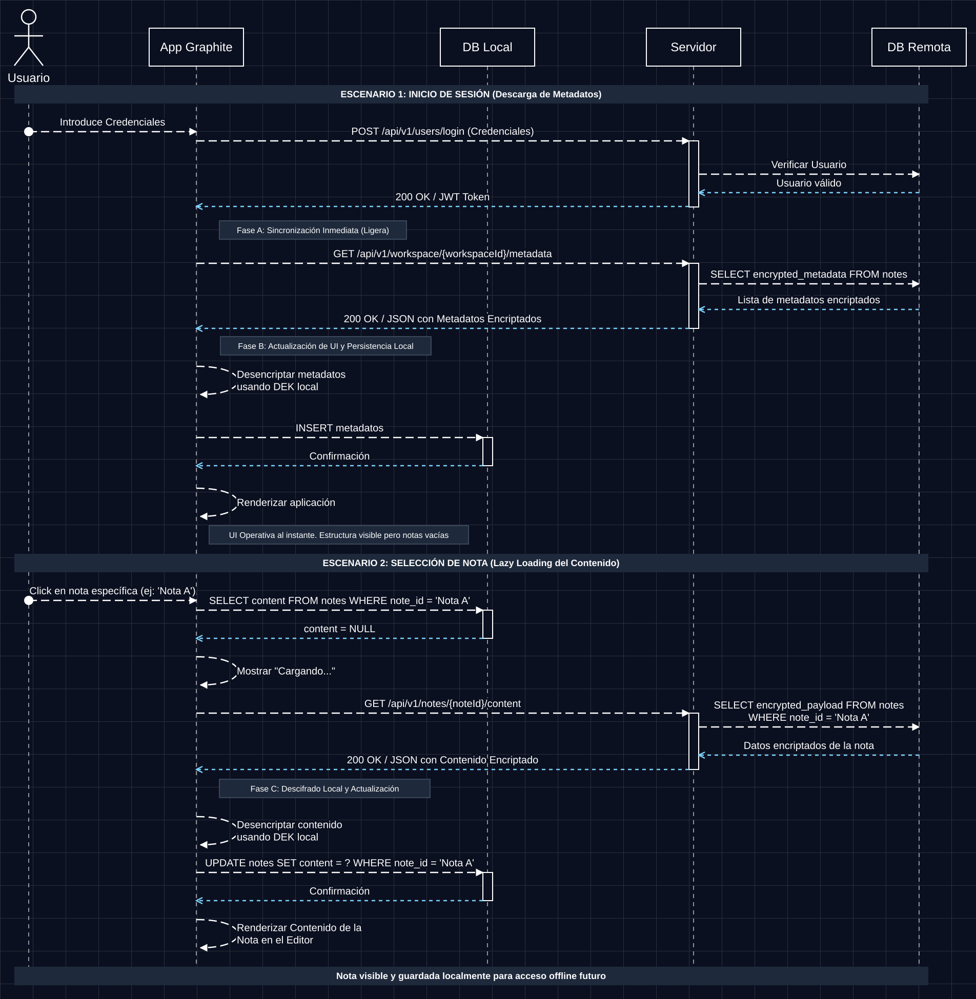
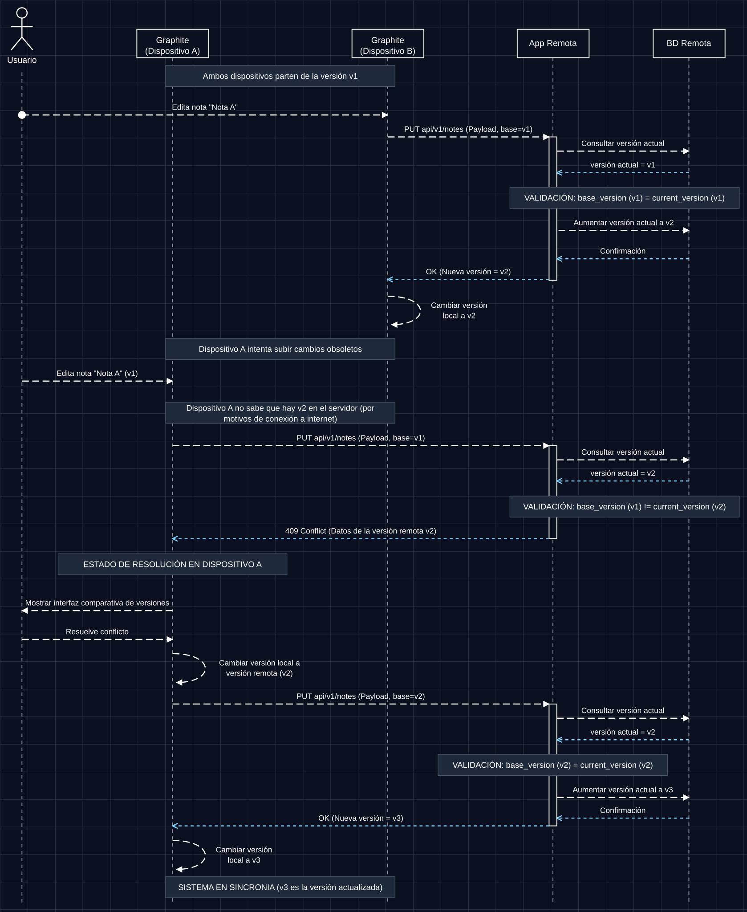
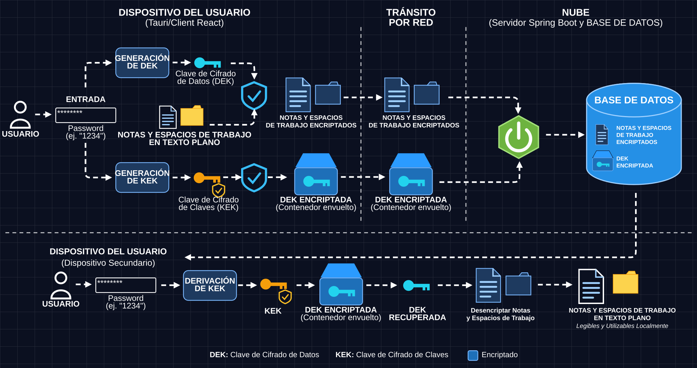

  
  

# Graphite

  

Una aplicación de notas multiplataforma, centrada en la privacidad y en el enfoque *local-first*, diseñada para ofrecer un control absoluto sobre tus datos y una sincronización fluida entre múltiples dispositivos.

*Graphite fue desarrollado como Trabajo de Fin de Grado (TFG) del Grado en Ingeniería del Software de la Universidad de Oviedo.*

---

## 📹 Demo

  

---

## ✨ Características

* **Edición de texto enriquecido:** Una experiencia de edición moderna y personalizable basada en **Tiptap**, con un comportamiento fluido por bloques y formato de texto avanzado.
* **Organización jerárquica:** Estructura tus ideas de forma eficiente mediante estructuras anidadas y relaciones dinámicas entre notas.
* **Motor de sincronización seguro:** Diseñado para intercambiar datos de forma fiable sin comprometer el rendimiento *local-first* ni las garantías de privacidad de la aplicación.

---

## 🚀 Pilares fundamentales

Graphite se construye sobre tres conceptos arquitectónicos fundamentales:

### 1. Local-First y funcionamiento sin conexión
* **Cero dependencia de la conectividad:** Todas las notas se almacenan, procesan y gestionan localmente en tu dispositivo. Puedes crear, editar y organizar tu base de conocimiento sin conexión a internet.
* **Rendimiento instantáneo:** Como las operaciones de datos se realizan directamente sobre el almacenamiento local, el renderizado de la interfaz y la edición de texto son fluidos, con una latencia prácticamente nula.
* **Primero los metadatos, el contenido bajo demanda:** Tras iniciar sesión, la aplicación solo descarga los metadatos ligeros (cifrados) de tu espacio de trabajo, los descifra localmente y los guarda en la base de datos local. La interfaz se muestra de inmediato con toda la estructura de tus notas, sin esperar a ningún contenido pesado.
* **Carga diferida con persistencia local:** Al abrir una nota por primera vez, su contenido cifrado se descarga, se descifra en tu dispositivo y se guarda en la base de datos local. A partir de ese momento, la nota se abre al instante desde el almacenamiento local y sigue disponible sin conexión.

  

> **Escenario 1 – Inicio de sesión:** se validan las credenciales, la aplicación recibe un JWT y sincroniza únicamente los metadatos cifrados (Fase A), que se descifran con la DEK local y se guardan localmente (Fase B).

> **Escenario 2 – Selección de una nota:** la aplicación consulta primero la base de datos local. Si el contenido aún no está allí, muestra un estado de carga, descarga el contenido cifrado, lo descifra localmente (Fase C), lo guarda y lo muestra en el editor.

### 2. Sincronización multidispositivo y compatibilidad
* **Sincronización en la nube sin fricción:** Incluye un módulo de sincronización robusto e independiente, capaz de resolver conflictos y de gestionar estructuras de datos jerárquicas entre distintos dispositivos.
* **Independiente de la plataforma:** Diseñado para funcionar de forma coherente en múltiples formatos de dispositivo, permitiéndote pasar de uno a otro de forma transparente mientras tu información se mantiene completamente actualizada.
* **Detección de conflictos basada en versiones:** Cada nota tiene un número de versión. Cada actualización se envía junto con la versión en la que se basó (`base_version`), y el servidor solo la acepta si esa versión coincide con la actual (`current_version`). Así se garantiza que ningún dispositivo sobrescriba silenciosamente cambios más recientes hechos en otro lugar.
* **Resolución segura de conflictos:** Si un dispositivo edita una nota sin conexión y más tarde intenta subir cambios desactualizados, el servidor rechaza la actualización con un `409 Conflict` y devuelve la última versión remota. La aplicación muestra entonces una interfaz de comparación de versiones para que decidas cómo resolverlo. No se pierde nada y, una vez resuelto, la actualización se reintenta sobre la última versión.

  

> **Ejemplo:** Los dispositivos A y B parten de `v1`. El dispositivo B sube primero su edición y la nota pasa a `v2`. El dispositivo A, que aún no sabe nada, intenta subir una edición basada en `v1`, recibe un `409 Conflict` con los datos remotos de `v2`, permite al usuario resolverlo y, finalmente, sube el resultado combinado sobre `v2`, lo que lleva el sistema a `v3`.

### 3. Privacidad absoluta (Zero-Knowledge y E2EE)
* **Cifrado de extremo a extremo (E2EE):** Tus notas se cifran en tu dispositivo local antes de tocar la red o los servidores en la nube.
* **Arquitectura de conocimiento cero (Zero-Knowledge):** El servidor de sincronización actúa como un intermediario ciego de datos. No puede leer, indexar ni analizar tu contenido. Solo tú posees las claves criptográficas necesarias para descifrar tu base de conocimiento.
* **Modelo de claves en dos capas (DEK + KEK):** Tus notas y espacios de trabajo se cifran con una **Data Encryption Key (DEK)** aleatoria generada en tu dispositivo. La propia DEK se cifra ("envuelve") con una **Key Encryption Key (KEK)** derivada localmente a partir de tu contraseña.
* **Qué almacena el servidor:** Solo las notas y espacios de trabajo cifrados, y la DEK envuelta (cifrada). La DEK en texto plano y la KEK nunca salen de tu dispositivo.
* **Recuperación en cualquier dispositivo:** En un dispositivo nuevo, la aplicación descarga la DEK envuelta, vuelve a derivar la KEK a partir de tu contraseña, desenvuelve la DEK y descifra tus notas localmente. Ninguna clave se envía nunca al servidor en un formato legible.

  

---

## 🛠️ Stack tecnológico

* **Frontend/Aplicación principal:** React
* **Núcleo de texto enriquecido:** Editor modular basado en Tiptap.
* **Backend de sincronización:** Servidor de sincronización personalizado, optimizado para la sincronización de datos con conocimiento cero, disponible en este otro repositorio: [Graphite-Sync](https://github.com/JavierSanabriaMiranda/Graphite-Sync).
