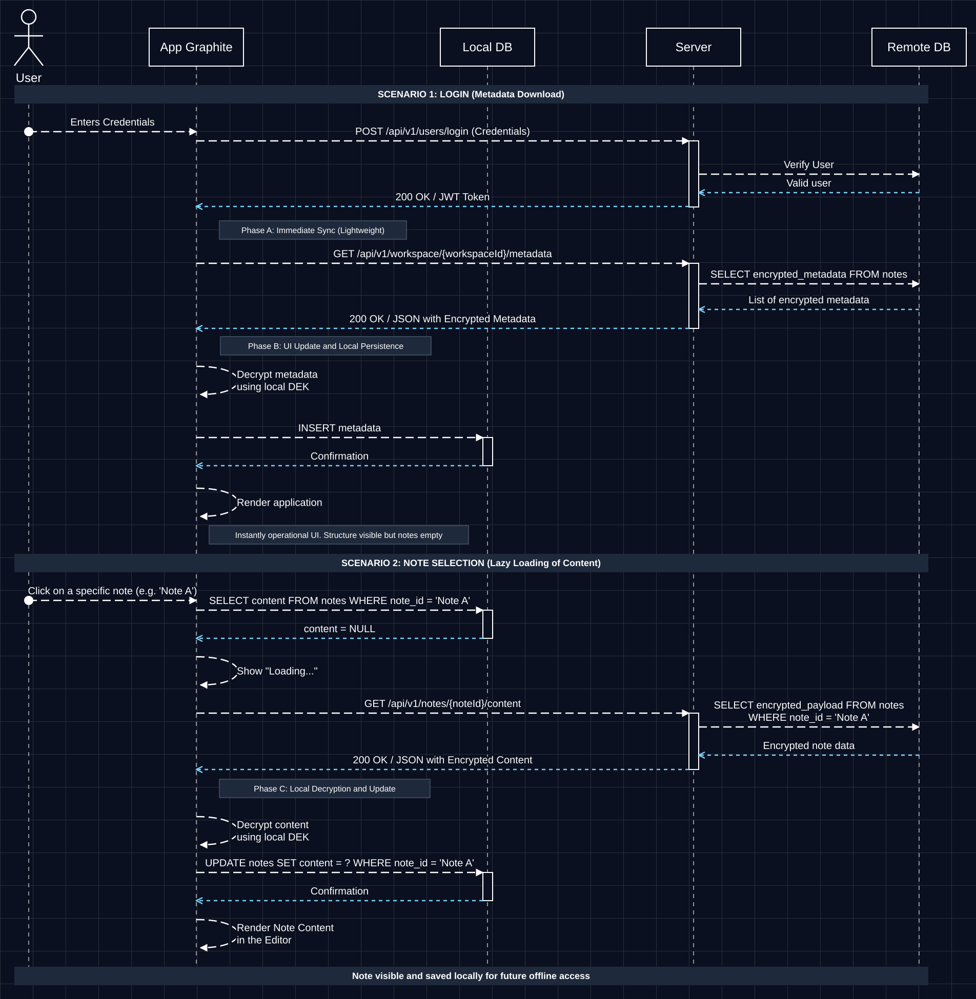
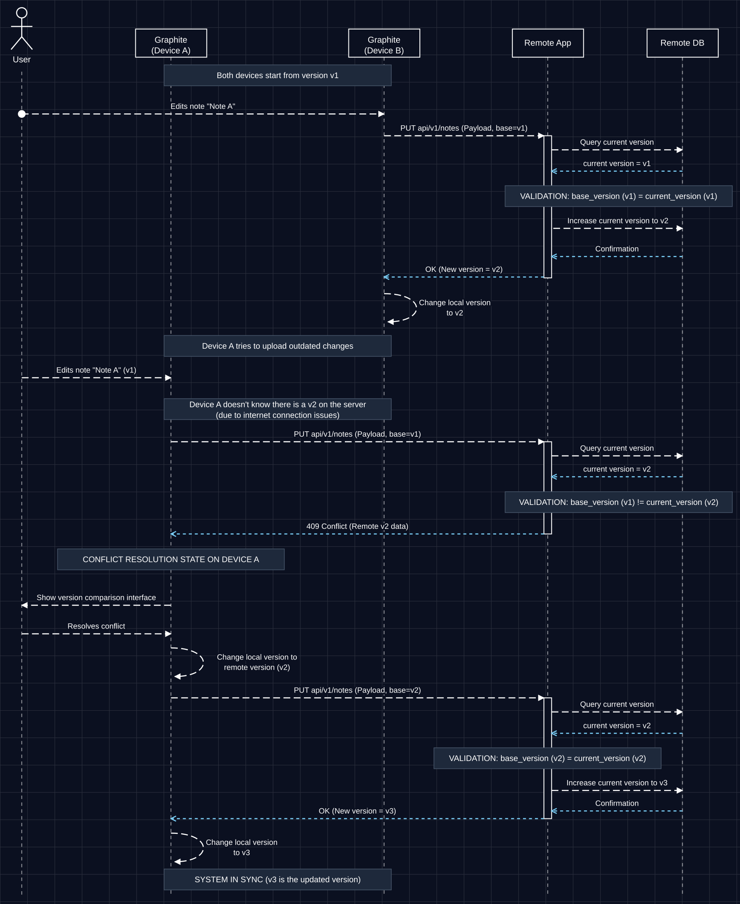
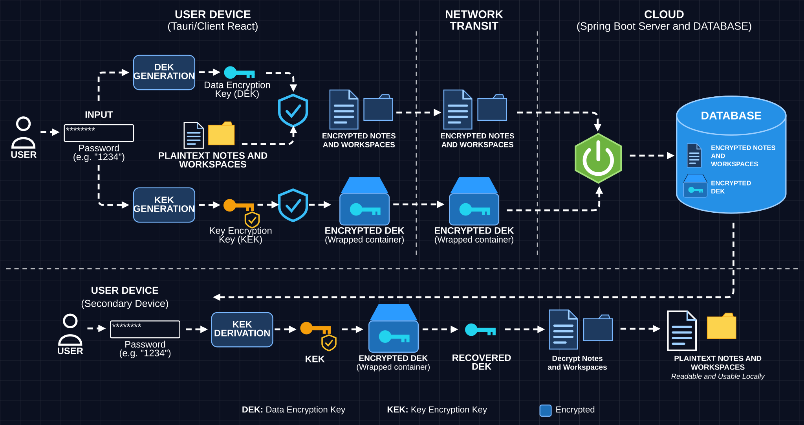

  
  

# Graphite

  

A privacy-first, local-first, and cross-platform note-taking application designed for absolute data ownership and seamless multi-device synchronization.

*Graphite was developed as a Final Degree Project (TFG) for the Software Engineering Degree at the University of Oviedo.*

---

## 📹 Demo

  

---

## ✨ Features

* **Rich Text Editing:** Powered by a customizable and modern editing experience using **Tiptap**, offering a fluid block-like behavior and advanced text formatting.
* **Hierarchical Organization:** Structure your thoughts efficiently using nested structures and dynamic note relations.
* **Secure Sync Engine:** Built to exchange data reliably without compromising on the application's local-first performance or privacy guarantees.

---

## 🚀 Core Pillars

Graphite is built around three fundamental architectural concepts:

### 1. Local-First & Offline Functionality
* **Zero Dependency on Connectivity:** All notes are stored, processed, and managed locally on your device. You can create, edit, and organize your knowledge base without an active internet connection.
* **Instantaneous Performance:** Since data operations happen directly against local storage, UI rendering and text editing are smooth, with virtually zero latency.
* **Metadata First, Content on Demand:** After login, the app only downloads the lightweight (encrypted) metadata of your workspace, decrypts it locally, and stores it in the local database. The UI renders immediately with the full structure of your notes, without waiting for any heavy content.
* **Lazy Loading with Local Persistence:** When you open a note for the first time, its encrypted content is fetched, decrypted on your device, and saved to the local database. From that moment on, the note opens instantly from local storage and stays available offline.

  

> **Scenario 1 – Login:** credentials are validated, the app receives a JWT and syncs only encrypted metadata (Phase A), which is decrypted with the local DEK and persisted locally (Phase B).

> **Scenario 2 – Note selection:** the app queries the local DB first. If the content is not there yet, it shows a loading state, downloads the encrypted payload, decrypts it locally (Phase C), stores it, and renders it in the editor.

### 2. Multi-Device Synchronization & Compatibility
* **Seamless Cloud Sync:** Features a robust, independent synchronization module capable of resolving conflicts and handling hierarchical data structures across different devices.
* **Platform Agnostic:** Designed to work cohesively across multiple form factors, allowing you to transition transparently from one device to another while keeping your information completely updated.
* **Version-Based Conflict Detection:** Every note carries a version number. Each update is sent together with the version it was based on (`base_version`), and the server only accepts it if that version matches the current one (`current_version`). This guarantees that no device silently overwrites newer changes made elsewhere.
* **Safe Conflict Resolution:** If a device edits a note while offline and later tries to upload outdated changes, the server rejects the update with a `409 Conflict` and returns the latest remote version. The app then shows a version comparison interface so you decide how to resolve it. Nothing is lost, and once resolved, the update is retried against the latest version.

  

> **Example:** Devices A and B both start from `v1`. Device B uploads its edit first and the note moves to `v2`. Device A, still offline-unaware, tries to upload an edit based on `v1`, receives a `409 Conflict` with the remote `v2` data, lets the user resolve it, and finally uploads the merged result on top of `v2`, which moves the system to `v3`.

### 3. Absolute Privacy (Zero-Knowledge & E2EE)
* **End-to-End Encryption (E2EE):** Your notes are encrypted on your local device before they ever touch the network or cloud servers.
* **Zero-Knowledge Architecture:** The synchronization server acts as a blind data relay. It cannot read, index, or analyze your content. Only you hold the cryptographic keys required to decrypt your knowledge base.
* **Two-Layer Key Model (DEK + KEK):** Your notes and workspaces are encrypted with a random **Data Encryption Key (DEK)** generated on your device. The DEK is itself encrypted ("wrapped") with a **Key Encryption Key (KEK)** derived locally from your password.
* **What the Server Stores:** Only encrypted notes and workspaces, and the wrapped (encrypted) DEK. The plaintext DEK and the KEK never leave your device.
* **Recovery on Any Device:** On a new device, the app downloads the wrapped DEK, derives the KEK again from your password, unwraps the DEK, and decrypts your notes locally. No keys are ever sent to the server in readable form.

  

---

## 🛠️ Tech Stack

* **Frontend/Core App:** React
* **Rich Text Core:** Tiptap-based modular editor.
* **Backend Sincronización:** Custom synchronization server optimized for zero-knowledge data synchronization on this other repo: [Graphite-Sync](https://github.com/JavierSanabriaMiranda/Graphite-Sync).
